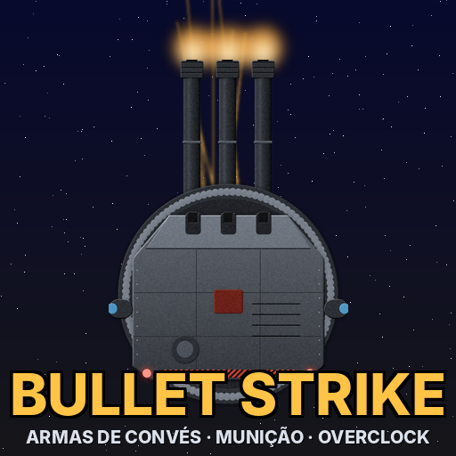

# Bullet Strike: armas de convés movidas a munição (mod para Cosmoteer)



**Bullet Strike** é um mod para **Cosmoteer: Starship Architect & Commander** focado em armas que usam
**munição** em vez de energia. Todas as armas são **de convés**: ficam por cima da nave, podem ser cercadas
de blindagem e atiram por cima do casco. Do começo ao fim do jogo, a sensação é de batalha naval no espaço:
traçantes, clarões de boca, granadas explodindo, flak enchendo o céu. É *tiro, porrada e bomba*.

- Versão do jogo: **0.30.4** (estável) e **0.30.5** (RC).
- Compatível com **Star Wars: A Cosmos Divided** (SW:ACD).
- Textos em **português (pt-BR)** e **inglês**.

> ⚠️ **Status: ainda não testado dentro do jogo.** Os arquivos foram gerados a partir dos arquivos de regras
> reais do Cosmoteer 0.30.5 e passaram por um validador que confere todas as referências, caminhos, imagens e
> textos (0 erros). Mesmo assim, só abrindo o jogo dá para ter certeza. Veja [Como testar](#como-testar).

## O que o mod traz

- **Só armas de convés, só munição, sem energia.** Cada arma precisa só de tripulação: quanto maior a
  arma, mais tripulantes.
- **Progressão por tamanho:**
  - **Início (1-2 blocos):** metralhadoras e autocanhões, alcance ~220-250 m.
  - **Meio:** minigun, metralhadora quádrupla, **canhão naval automático** ("tum, tum, tum"), gatling de
    plasma, CIWS. Alcance ~300-340 m.
  - **Fim:** canhão rotativo de 30 mm, torre naval dupla de 155 mm, canhão de plasma pesado, **obuseiro
    nuclear** e a **torre tripla de 406 mm** de encouraçado. Alcance 500-600 m.
- **Defesa multi-alvo:** flak/CIWS com explosão aérea que danifica **vários** mísseis, minas, granadas,
  disparos laser e tiros iônicos (inclusive os do SW:ACD) **de uma vez**. Em compensação, gasta muita munição.
  Feixes (como o do prisma iônico) não podem ser abatidos, igual ao jogo base.
- **Carregadores em vez de fitas de munição:** a fábrica produz munição, a **prensa** empacota em
  carregadores e a tripulação leva o carregador até a arma. Os carregadores especiais (Perfurante, EMP) e os
  projéteis nucleares são feitos a partir dos carregadores Padrão; Perfurante e Perfurante-Explosiva usam o
  mesmo carregador. Cada arma abre o carregador em N disparos
  (por exemplo, 50 tiros de metralhadora). Nada de fileiras de magazines ocupando a nave.
- **Seletor de munição** nas armas de meio e fim de jogo, igual ao do lança-mísseis:
  **Padrão**, **Perfurante** (atravessa blindagem), **Perfurante-Explosiva** (atravessa e explode dentro do
  casco) e **EMP** (drena um pouco de escudo e bateria a cada acerto).
- **Munições especiais:** **células de plasma** (ótimas contra escudos) e **projéteis nucleares**.
- **Lança-mísseis de convés** (em construção): a **Tocandira** (início, 2x2) já está no mod: uma caixa de
  micromísseis estilo RAM que dispara 12 micromísseis em sequência. A tripulação enche um paiol interno com as
  peças de míssil do jogo base; um autocarregador recarrega as células **só enquanto há tripulação no posto**.
  Mísseis Muriçoca (alto-explosivo) e Taturana-mirim (incendiário). Os mísseis do meio e do fim de jogo já são
  gerados (Jararaca, Piranha de submunições, Carrapato grudento, Taturana, Poraquê PEM, Boto com iscas e o torpedo
  nuclear Iara); os lançadores Caipora (meio) e Mula-sem-Cabeça (fim) vêm na próxima etapa. Projeto completo em
  [docs/MISSEIS_PROJETO.md](docs/MISSEIS_PROJETO.md).
- **Overclock** nas armas de meio e fim de jogo: mais cadência, dano ou alcance em troca de calor.
- **Aba própria "Bullet Strike"** no menu de construção, techs no modo **Carreira** e no **Build & Battle**.
- **Limite por nave:** no máximo 2 obuseiros nucleares e 2 torres de 406 mm (a arma do encouraçado),
  para não ficar roubado.
- **Arma de fim de jogo muito forte, mas muito cara:** a torre tripla de 406 mm causa ~16.000 de dano por
  segundo a 600 m, mas exige 10 tripulantes, 20 pontos de comando e uma linha de munição pesada
  (~30 viagens de carregadores por minuto).

A tabela completa de armas, munições e fábricas (com alcance, DPS, tripulação e receitas) está em
**[docs/ARMAS.md](docs/ARMAS.md)**. As imagens de cada peça ficam em [docs/preview](docs/preview).

## Como instalar

1. Baixe esta pasta do repositório: **`BulletStrike/`**.
2. Copie a pasta inteira para a pasta de mods do Cosmoteer:
   - Windows: `C:\Users\<seu usuário>\Saved Games\Cosmoteer\<seu SteamID>\Mods\`
   - O resultado deve ficar assim: `...\Mods\BulletStrike\mod.rules`
3. Abra o Cosmoteer, vá em **Mods**, ative o **Bullet Strike** e reinicie o jogo.
4. Para usar com o Star Wars: A Cosmos Divided, basta ativar os dois. Não importa a ordem.

## Como testar

1. Abra o jogo com o **modo desenvolvedor** (na Steam: botão direito no Cosmoteer → Propriedades →
   Opções de inicialização → `--devmode`). Assim os erros de carregamento aparecem com detalhes.
2. Se o jogo travar ao carregar, o motivo aparece nas primeiras ~20 linhas do log, acima de
   `--- End of inner exception stack trace ---`. Mande essas linhas que eu corrijo.
3. No **modo Criativo**, monte uma nave de teste e confira:
   - [ ] As peças aparecem na aba **Bullet Strike** e dá para colocá-las cercadas de blindagem.
   - [ ] A tripulação leva munição/carregadores até as armas, e a arma atira por cima do casco.
   - [ ] O botão de **seletor de munição** troca entre Padrão / Perfurante / Perfurante-Explosiva / EMP.
   - [ ] O **overclock** liga e gera calor (precisa de tubos de calor/radiadores, igual às armas do jogo).
   - [ ] A minigun e o canhão rotativo **aceleram** enquanto atiram.
   - [ ] A flak/CIWS derruba mísseis e projéteis (teste no modo Defender).
   - [ ] As fábricas (prensas) produzem carregadores, células de plasma e projéteis nucleares.

## Compatibilidade com Star Wars: A Cosmos Divided

- O Bullet Strike **não substitui nenhum arquivo** do jogo nem do SW:ACD: só **adiciona** peças, recursos,
  techs e textos (ações `AddMany`/`Add`).
- Todos os IDs têm prefixo próprio (`rafaeltessaro.bs_*`, `BS*`), então não há colisão de nomes.
- As defesas miram também a categoria `ion_shot` (tiros iônicos do SW:ACD) e `laser` (turbolasers).
- O limite de obuseiros nucleares usa o mesmo método em duas etapas do SW:ACD, então os dois mods convivem.
- As armas do Bullet Strike não usam bateria, então os canhões iônicos do SW:ACD quase não as afetam. Em
  troca, a munição **EMP** é forte contra as naves do SW:ACD, que dependem de energia.

## Como mudar o balanceamento

Todos os números ficam em **`tools/spec/bullet_strike_spec.json`** (dano, alcance, cadência, tripulação,
custo, receitas das fábricas...). Depois de editar, gere o mod de novo:

```bash
python3 tools/build_mod.py --vanilla <pasta Data do Cosmoteer>   # gera BulletStrike/ (regras + arte + textos)
python3 tools/make_docs.py                                        # atualiza docs/ARMAS.md
python3 tools/rules_lint.py --mod BulletStrike --vanilla <pasta Data do Cosmoteer>   # valida
```

- Precisa de Python 3 com **Pillow** e **numpy** (`pip install pillow numpy`).
- A pasta `Data` fica em `steamapps\common\Cosmoteer\Data`.
- Estilo de arte, efeitos e textos ficam em `tools/bs_data.py` e `tools/bs_strings.py`.

### Estrutura do repositório

| Caminho | O que é |
|---|---|
| `BulletStrike/` | **O mod pronto** (copie esta pasta para o jogo) |
| `tools/spec/bullet_strike_spec.json` | Números de balanceamento |
| `tools/spec/bullet_strike_missiles.json` | Projeto e números dos lança-mísseis (com as variantes de mecânica) |
| `tools/build_mod.py` | Gera o mod inteiro |
| `tools/bsgen/` | Geradores de peças, projéteis, fábricas, recursos e arte procedural |
| `tools/rules_lint.py` | Validador de arquivos `.rules` (referências, caminhos, imagens, textos) |
| `tools/schema_check.py` | Compara os campos usados pelo mod com os do jogo base |
| `docs/ARMAS.md` | Tabela de armas, munições e fábricas |

## Créditos

- Ideia e direção: **Rafael Tessaro**.
- Arte procedural, regras e ferramentas geradas com ajuda do Claude (Anthropic).
- Efeitos sonoros e partículas reaproveitam os do Cosmoteer por referência (nada do jogo é copiado para o mod).
