# Bullet Strike: armas de convés movidas a munição (mod para Cosmoteer)

<p align="center"></p>

> **[2.0 de TESTE]** Esta é a versão 2.0 em teste (versão 2.0.0). Ela ainda precisa ser testada no jogo: siga o **[checklist](docs/CHECKLIST_2_0.md)** e me mande as respostas. A versão final 2.0.0 só sai depois disso.
>
> ⚠️ **Saves da 1.x:** Abrir um save da 1.x com a 2.0 pode fechar o jogo (crash). Termine ou guarde a carreira 1.x antes (ou mantenha uma cópia da pasta da 1.x); naves da 1.x precisam ser refeitas.
>
> **Balanço:** Balanceado para jogar com o Star Wars: A Cosmos Divided; sem ele as armas do início e do meio do jogo ficam ~2-3x mais fortes por tile que as do jogo base.

**Bullet Strike** é um mod para **Cosmoteer: Starship Architect & Commander** com armas de convés que gastam **munição** em vez de energia. Na 2.0 a munição tem uma cadeia de verdade: **fábricas** fazem carregadores, células e cargas de míssil, os **paióis** guardam e a **Fita de Alimentação** leva tudo até as armas, de um canto ao outro da nave.

- **16 armas**, **3 defesas** e **3 lança-mísseis**, divididos em início, meio e fim de jogo.
- **6 fábricas**, **12 paióis** e a **Fita de Alimentação**.
- **12 itens de munição** com visual futurista.
- Jogo: **0.30.4c**. Feito para jogar junto com o **Star Wars: A Cosmos Divided** (SW:ACD).
- Textos em **português (pt-BR)** e **inglês**.

## Índice

- [Novidades da 2.0](#novidades-da-20)
- [Qual pasta instalar](#qual-pasta-instalar)
- [Como instalar](#como-instalar)
- [Como testar](#como-testar)
- [Galeria](#galeria)
- [Armas por fase](#armas-por-fase)
- [Logística em um minuto](#logística-em-um-minuto)
- [Limites por nave](#limites-por-nave)
- [Compatibilidade com Star Wars: A Cosmos Divided](#compatibilidade-com-star-wars-a-cosmos-divided)
- [Para quem quer mexer no mod](#para-quem-quer-mexer-no-mod)
- [Créditos](#créditos)

## Novidades da 2.0

- **Fita de Alimentação (teletransporte):** Grude do lado de uma fábrica, paiol ou arma do Bullet Strike: a máquina entra na rede da fita e a munição passa sozinha entre elas, de um canto ao outro da nave (teletransporte, sem caminho e sem tripulação). A luz verde acende quando está grudada. Uma fita encostada em duas máquinas liga as duas. A fábrica com Fita manda para os paióis com Fita; o paiol com Fita empurra para as armas com Fita no tipo escolhido. A tripulação continua de reserva: abastece a arma que cair abaixo da metade.
- **Paióis:** cartuchos, células, mísseis e projéteis, de 1x1 a 3x3. O tipo é escolhido no botão do paiol; barra e medidor no teto (5 / 8 / 10 níveis). Na nave com a Fita eles são selados.
- **Fábricas F1 a F6:** etapa única, sem tripulante, com overclock (3x). Vizinhança ligada como no jogo base (+25 % por fábrica vizinha).
- **Munições:** **HE** (Alto-Explosivo); **AP** (Perfurante); **SAP** (Semiperfurante); **AC** (Alta Capacidade); **FRAG** (Nuvem de Fragmentos). Cada tipo tem o seu estoque na arma, e um tipo nunca vira outro.
- **Linha PEM:** Tuvira (torre de 270°), Treme-Treme e Corisco (overclock Relâmpago): drenam o escudo, como os íons do SW.
- **Railgun Tupã:** fixa e modular: Carregador 5x5 + 1 a 6 canos + Ponta. Mais canos = mais dano, alcance, penetração e energia por tiro. Dá um **tranco** a cada disparo e o dardo passa por cima da própria nave.
- **Mísseis:** Jararaca, Piranha, Poraquê e Iara (HE, submunição, PEM e nuclear).
- **Visual futurista:** itens, granadas, mísseis e ícones novos; brilho dos projéteis só no espaço (o casco branco não fica lavado).
- **Ruptura limpa com a 1.x:** veja o aviso no topo (saves e naves da 1.x não passam para a 2.0).

## Qual pasta instalar

| Pasta | Nome na lista de mods | Quando usar |
|---|---|---|
| `BulletStrike/` | Bullet Strike | Principal, com a Fita de Alimentação. |
| `testes/BulletStrike_SemFita/` | Bullet Strike (reserva sem Fita) | Reserva: as mesmas armas, paióis e fábricas, sem a Fita (a tripulação leva a munição; paiol encostado na arma ou na fábrica passa a munição sozinho). Use se a principal não carregar. |

**Nunca ative as duas juntas:** as peças têm os mesmos IDs. As naves passam de uma para a outra (na reserva as Fitas somem). Os zips de teste ficam em `testes/` e trazem o `CHECKLIST_2_0_CURTO.txt`.

## Como instalar

1. Guarde uma cópia da pasta da 1.x e da sua carreira.
2. Copie a pasta `BulletStrike` para a pasta de mods do Cosmoteer (Windows: `C:\Users\<seu usuário>\Saved Games\Cosmoteer\<seu SteamID>\Mods\`). O resultado deve ficar `...\Mods\BulletStrike\mod.rules`. Apague a pasta antiga antes (arquivos que mudaram de nome ficariam sobrando).
3. Se quiser a reserva, copie também `BulletStrike_SemFita`, mas deixe desativada.
4. Abra o Cosmoteer, vá em **Mods**, ative o **Bullet Strike** e reinicie. Para jogar com o SW:ACD, ative os dois (a ordem não importa).

## Como testar

O roteiro é o **[docs/CHECKLIST_2_0.md](docs/CHECKLIST_2_0.md)**: começa pelo carregamento e pela Fita e segue família por família. A versão curta (`CHECKLIST_2_0_CURTO.txt`) vai dentro dos zips. Dicas e o que está valendo enquanto os testes não voltam: [docs/COMO_TESTAR.md](docs/COMO_TESTAR.md).

## Galeria

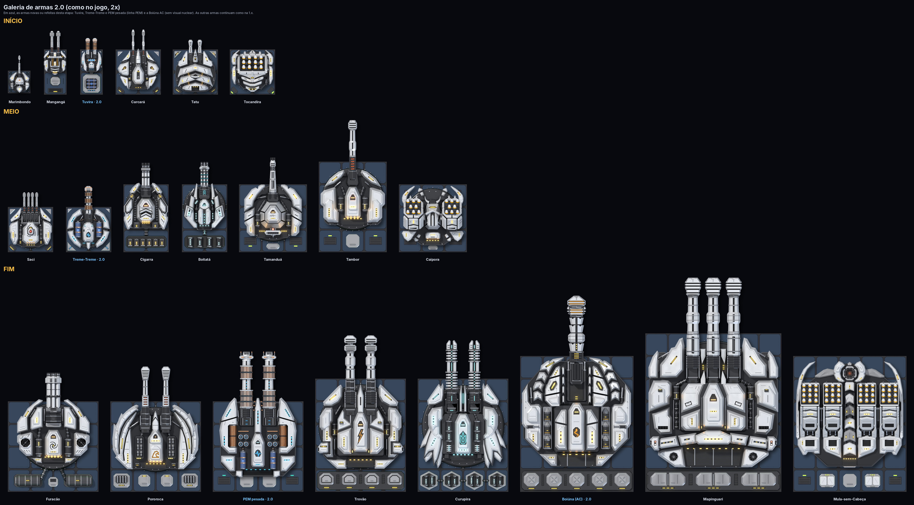

<p align="center"><i>Armas e defesas da 2.0 por fase</i></p>

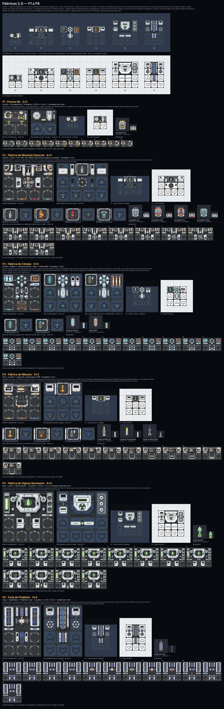

<p align="center"><i>As 6 fábricas (F1 a F6)</i></p>

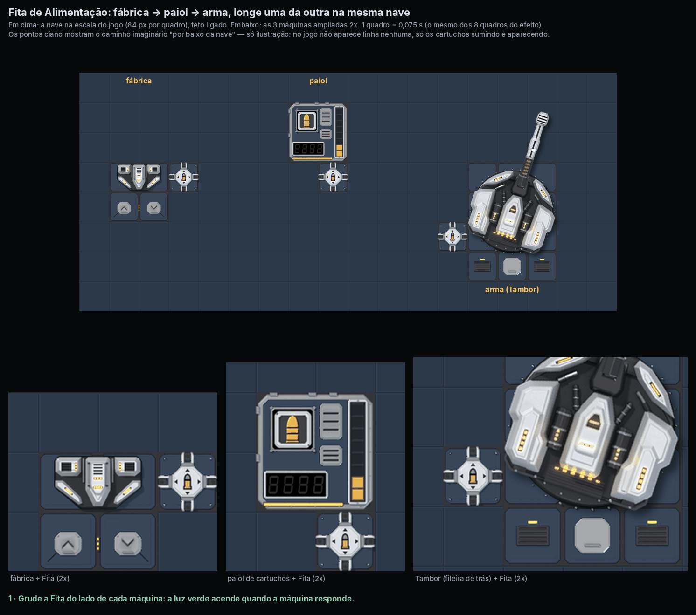

<p align="center"><i>A Fita de Alimentação: cartuchos saindo da fábrica e entrando no paiol e na arma</i></p>

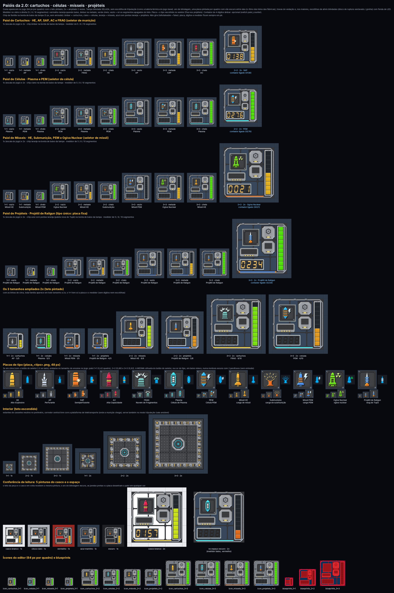

<p align="center"><i>Os paióis (cartuchos, células, mísseis e projéteis)</i></p>

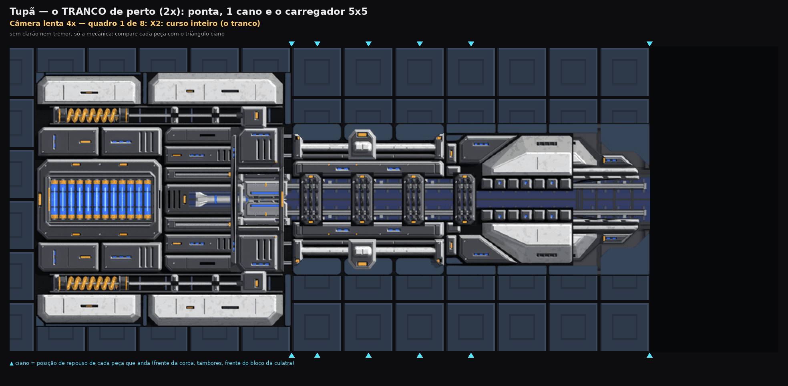

<p align="center"><i>Railgun Tupã: o tranco no disparo</i></p>

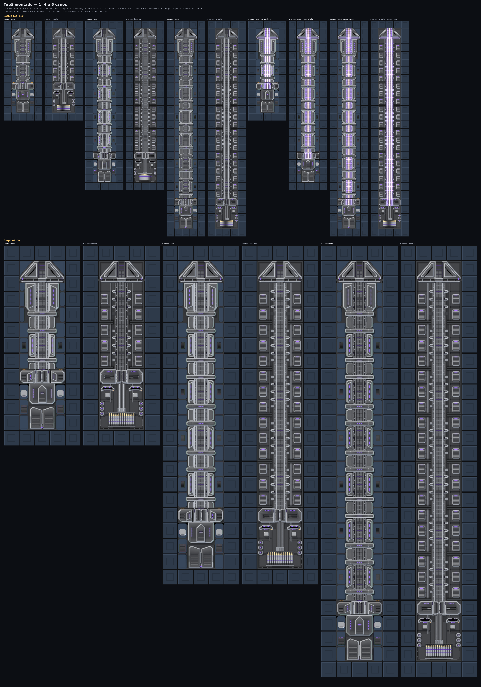

<p align="center"><i>Railgun Tupã montada (carregador, canos e ponta)</i></p>

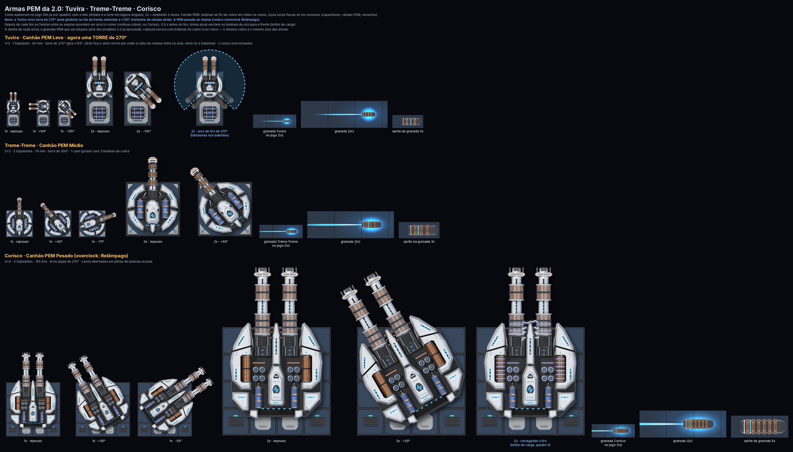

<p align="center"><i>Linha PEM</i></p>

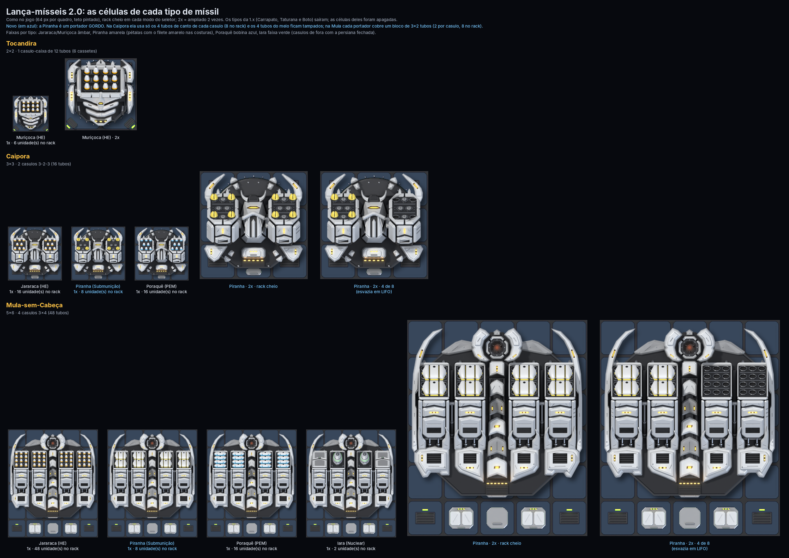

<p align="center"><i>Lança-mísseis e mísseis</i></p>

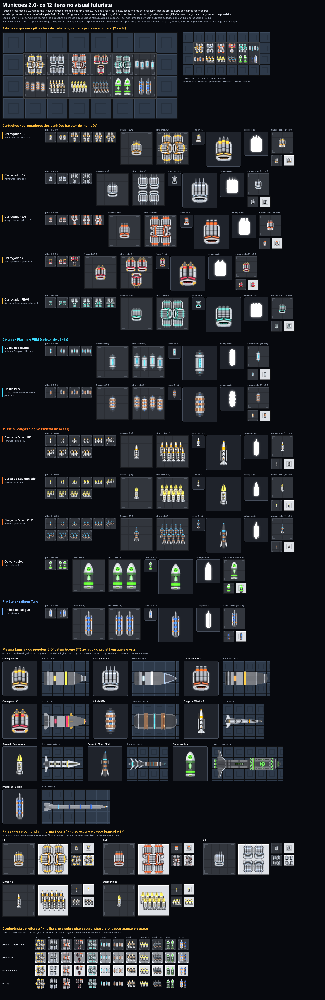

<p align="center"><i>Os itens de munição</i></p>

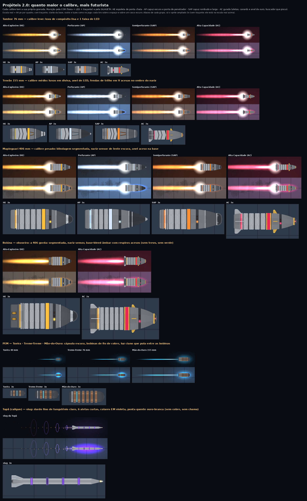

<p align="center"><i>Projéteis futuristas por calibre</i></p>

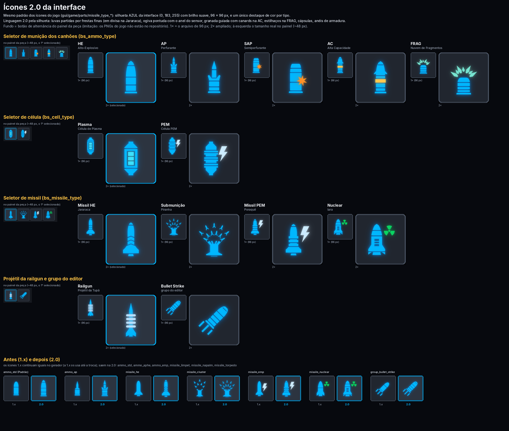

<p align="center"><i>Ícones dos botões</i></p>

Todas as prévias da 2.0: [docs/preview/3d/v2/](docs/preview/3d/v2/) (veja também [docs/preview/2.0/LEIA.md](docs/preview/2.0/LEIA.md)).

## Armas por fase

Os números completos (dano, vida, custo, consumo, logística) ficam em **[docs/ARMAS.md](docs/ARMAS.md)**; os lança-mísseis, em **[docs/MISSEIS_PROJETO.md](docs/MISSEIS_PROJETO.md)**.

### Início de jogo

| Codinome | Arma | Tamanho | Tripulação | Alcance | Munições |
|---|---|---|---|---|---|
| **Marimbondo** | Metralhadora Leve de Convés | 1x1 | 1 | 360 m | HE/AP |
| **Mangangá** | Metralhadora Pesada de Convés | 1x2 | 1 | 380 m | HE/AP |
| **Carcará** | Canhão Automático de Convés 20 mm | 2x2 | 1 | 380 m | HE/AP/SAP |
| **Tatu** | Flak Leve de Convés (defesa) | 2x2 | 1 | 180 m | HE/FRAG |
| **Tuvira** | Canhão PEM Leve | 1x2 | 1 | 380 m | PEM |
| **Tocandira** | Caixa de Micromísseis de Convés | 2x2 | 1 | 600 m | HE |

### Meio de jogo

| Codinome | Arma | Tamanho | Tripulação | Alcance | Munições |
|---|---|---|---|---|---|
| **Saci** | Metralhadora Pesada Quádrupla | 2x2 | 2 | 420 m | HE/AP |
| **Cigarra** | Minigun de Convés | 2x3 | 2 | 420 m | HE/AP |
| **Tambor** | Canhão Naval Automático 76 mm | 3x4 | 3 | 450 m | HE/AP/SAP/AC |
| **Boitatá** | Gatling de Plasma | 2x3 | 2 | 420 m | Plasma |
| **Tamanduá** | CIWS de Convés (defesa) | 3x3 | 2 | 250 m | HE/FRAG |
| **Treme-Treme** | Canhão PEM Médio | 2x2 | 2 | 440 m | PEM |
| **Caipora** | Lançador Duplo de Mísseis de Convés | 3x3 | 2 | 800 m | HE/Submunição/PEM |

### Fim de jogo

| Codinome | Arma | Tamanho | Tripulação | Alcance | Munições |
|---|---|---|---|---|---|
| **Furacão** | Canhão Rotativo Pesado 30 mm | 4x4 | 4 | 520 m | HE/AP/SAP |
| **Trovão** | Canhão Naval Duplo 155 mm | 4x5 | 5 | 560 m | HE/AP/SAP/AC |
| **Mapinguari** | Torre Naval Tripla 406 mm | 6x7 | 7 | 620 m | HE/AP/SAP/AC |
| **Boiúna** | Obuseiro Pesado de Convés (AC) | 5x6 | 5 | 600 m | HE/AC |
| **Curupira** | Canhão de Plasma Pesado | 4x5 | 4 | 580 m | Plasma |
| **Pororoca** | Bateria Flak Pesada (defesa) | 4x4 | 4 | 320 m | HE/FRAG |
| **Corisco** | Canhão PEM Pesado | 4x4 | 3 | 520 m | PEM |
| **Mula-sem-Cabeça** | Bateria Pesada de Mísseis Quádrupla | 5x6 | 8 | 1.000 m | HE/Submunição/PEM/Nuclear |
| **Tupã** | Railgun (Carregador + 1 a 6 Canos + Ponta) | 46 a 91 tiles | 2 | 500 a 700 m | Projétil |

## Logística em um minuto

1. **Fábrica:** faz a munição (carregador, célula, carga de míssil, ogiva ou projétil) com matéria-prima do jogo base e energia.
2. **Paiol:** guarda a munição; você escolhe o tipo no botão dele.
3. **Arma:** guarda um estoque de ~60 s de tiro (~75 s no fim de jogo) e gasta enquanto atira.
4. **Fita:** grudada na fábrica, no paiol e na arma, leva a munição de uma para a outra sem caminho e sem tripulação. Sem a Fita, a tripulação leva, como no jogo base, quando a arma cai abaixo da metade.

## Limites por nave

- **Canhões de Encouraçado** (Mapinguari e Boiúna somados): no máximo 2 por nave.
- **Baterias de Mísseis Nucleares** (Mula-sem-Cabeça): no máximo 2 por nave.
- **Railguns Tupã** (Ponta do Tupã): no máximo 2 por nave.

## Compatibilidade com Star Wars: A Cosmos Divided

- O Bullet Strike **não substitui nenhum arquivo** do jogo nem do SW:ACD: só **adiciona** peças, recursos, techs e textos, com prefixo próprio (`rafaeltessaro.bs_*`, `BS*`).
- **Balanceado para jogar com o SW:** cada arma bate ~15 % mais que a equivalente do SW no mesmo nível, e paga em logística (fábricas, paióis e estoque).
- As defesas derrubam mísseis, minas e balas (1,15x, 1,17x e 1,15x a defesa do SW) e também parte dos lasers e íons do SW (0,55-0,80x). Os feixes contínuos do SW não são projéteis e não podem ser abatidos.
- A linha PEM e o míssil Poraquê drenam o escudo como os íons do SW. As armas do Bullet Strike não usam bateria (menos o Tupã, que gasta a bateria do carregador), então os íons do SW quase não as afetam. As fábricas usam bateria e sentem os íons.
- Os limites por nave usam o mesmo método do SW:ACD, então os dois mods convivem.

## Para quem quer mexer no mod

Os arquivos de `BulletStrike/` e de `testes/BulletStrike_SemFita/` são **gerados**: não edite à mão. Os números ficam em `tools/spec/SPEC_2.0.json` (dividido em `tools/spec/bullet_strike_*.json` por `tools/spec2_split.py`); as escolhas de build ficam em `tools/spec/bullet_strike_switches.json`.

```bash
python3 tools/build_mod.py --variante fita --vanilla "$COSMOTEER_DATA" --out BulletStrike
python3 tools/build_mod.py --variante semfita --vanilla "$COSMOTEER_DATA" --out testes/BulletStrike_SemFita
python3 tools/make_docs.py --estrito          # README, docs/ e checklist (--curto CAMINHO: o curto)
python3 tools/spec2_check.py --mod BulletStrike --vanilla "$COSMOTEER_DATA" --docs
python3 tools/rules_lint.py --mod BulletStrike --vanilla "$COSMOTEER_DATA"
```

- `$COSMOTEER_DATA` = a pasta `Data` do jogo (`steamapps\common\Cosmoteer\Data`).
- Precisa de Python 3 com **Pillow** e **numpy** (`pip install pillow numpy`).
- Um switch pode ser trocado só num build: `--switch grupo.nome=valor` (ex.: `--switch logistics.fita_alcance=12`).
- A arte 3D fica em `art3d/` (renders prontos) e os modelos em `tools/blender/`; o build só copia os renders. `python3 tools/check_art3d.py todos --estrito` confere tudo.

| Caminho | O que é |
|---|---|
| `BulletStrike/` | O mod pronto, com a Fita |
| `testes/BulletStrike_SemFita/` | A reserva sem a Fita |
| `tools/spec/` | Spec 2.0, switches, addendum e o texto do checklist (`checklist_2_0.json`) |
| `tools/build_mod.py` | Gera o mod (`--variante fita` ou `semfita`) |
| `tools/bs_data.py` | Camada de dados: lê o spec e os switches |
| `tools/bsgen/` | Geradores das peças, tiros, fábricas, paióis, Fita e efeitos |
| `tools/make_docs.py` | Gera este README e os docs |
| `tools/spec2_check.py` / `tools/rules_lint.py` | Conferências do mod gerado |
| `art3d/` | Renders 3D das peças e munições |
| `docs/` | ARMAS, MISSEIS_PROJETO, COMO_TESTAR, CHECKLIST_2_0 e as prévias |

## Créditos

- Ideia e direção: **Rafael Tessaro**.
- Arte 3D, regras e ferramentas feitas com ajuda do Claude (Anthropic).
- Sons, imagens de partículas e a maior parte dos efeitos reaproveitam os do Cosmoteer por referência. Alguns arquivos de partículas do jogo são copiados como texto (`tools/vanilla_fx/`), só com tamanho, quantidade e posição ajustados; nenhuma imagem nem som do jogo é copiado para o mod.
