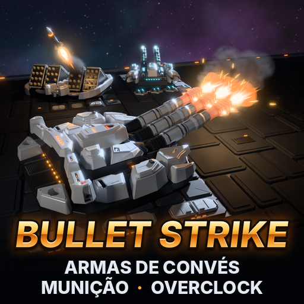
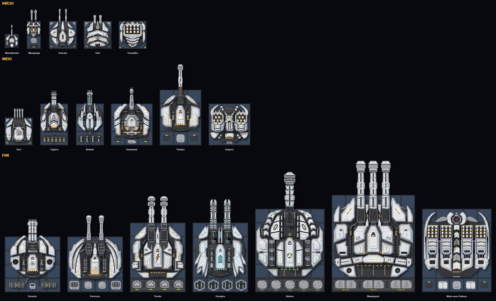
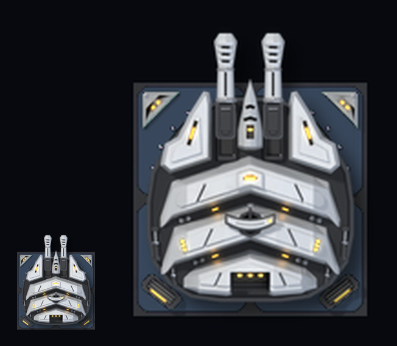
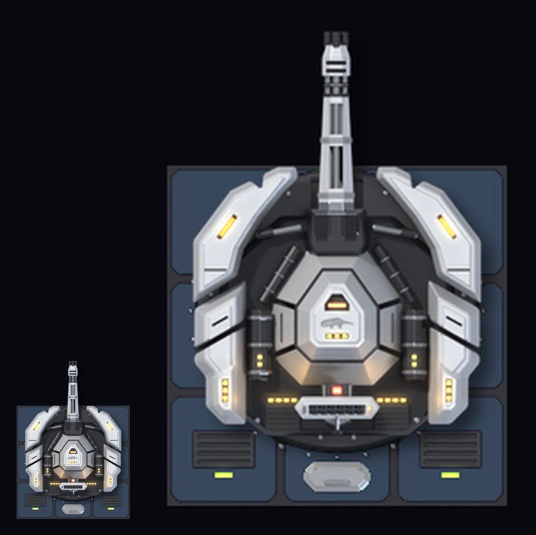
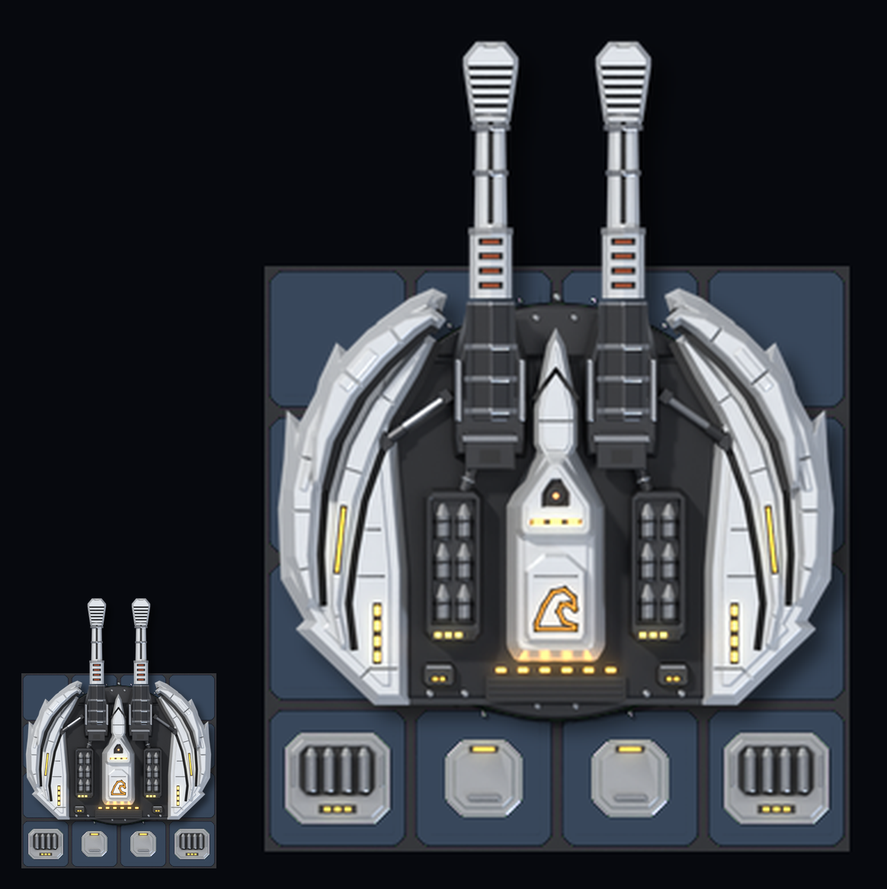
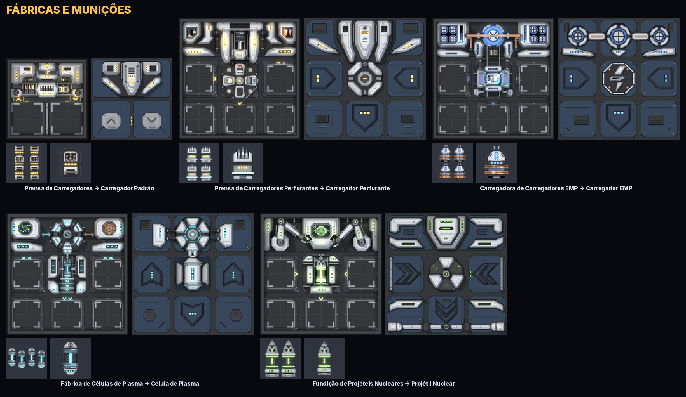
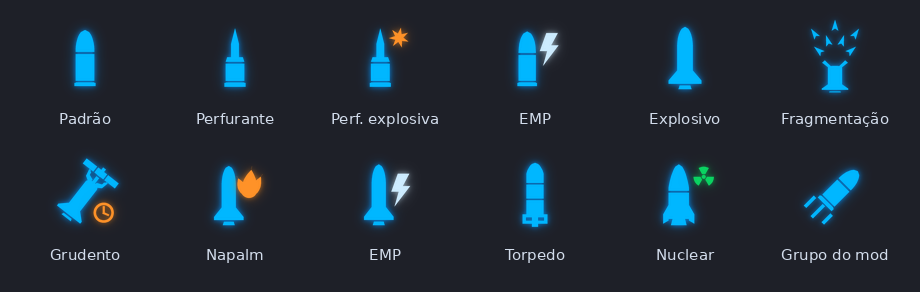
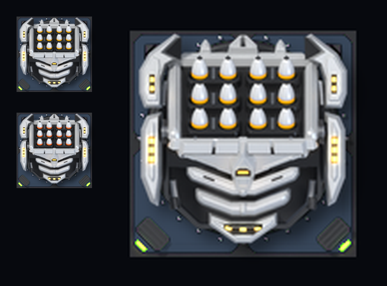
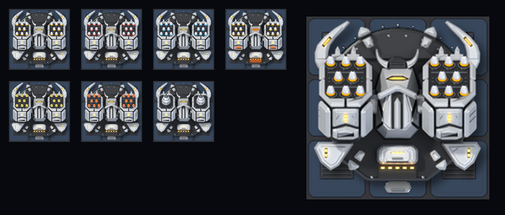
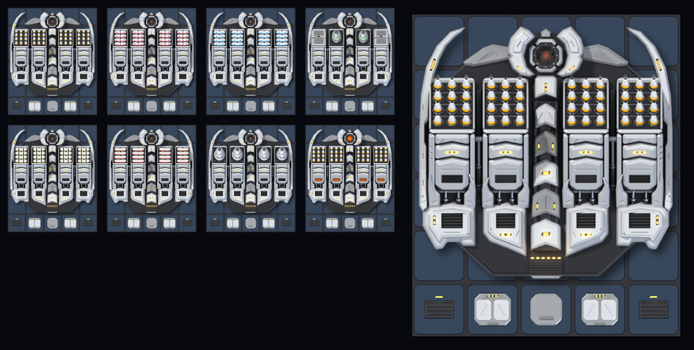

# Bullet Strike: armas de convés movidas a munição (mod para Cosmoteer)

<p align="center"></p>

**Bullet Strike** é um mod para **Cosmoteer: Starship Architect & Commander** com armas que usam **munição** em
vez de energia. Todas as armas são **de convés**: ficam por cima da nave, podem ser cercadas de blindagem e atiram
por cima do casco. Do começo ao fim do jogo, a sensação é de batalha naval no espaço: traçantes, clarões de boca,
granadas explodindo, flak enchendo o céu e salvas de mísseis saindo em sequência. É *tiro, porrada e bomba*.

- **15 armas** (metralhadoras, autocanhões, canhões navais, plasma, flak/CIWS e um obuseiro nuclear) e
  **3 lança-mísseis de convés** com **7 tipos de míssil**, divididos em início, meio e fim de jogo.
- **Logística de verdade:** a tripulação carrega **carregadores** das fábricas até as armas. **5 fábricas** novas,
  todas com **overclock** no estilo do jogo base.
- **Seletor de munição:** Padrão, Perfurante, Perfurante-Explosiva e P.E.M., além de **células de plasma** e
  **projéteis nucleares**.
- Versão do jogo: **0.30.4** (estável) e **0.30.5** (RC).
- Compatível com **Star Wars: A Cosmos Divided** (SW:ACD).
- Textos do jogo em **português (pt-BR)** e **inglês**.

> ⚠️ **Status: ainda falta testar dentro do jogo.** Os arquivos são gerados a partir das regras reais do
> Cosmoteer 0.30.5 e passam por um validador que confere todas as referências, caminhos, imagens e textos
> (0 erros, 0 avisos). Mesmo assim, só abrindo o jogo dá para ter certeza. Veja [Como testar](#como-testar).

## Índice

- [Galeria](#galeria)
- [Armas por fase](#armas-por-fase)
- [Munição e logística](#munição-e-logística)
- [Overclock](#overclock)
- [Mísseis de convés](#mísseis-de-convés)
- [Limites por nave](#limites-por-nave)
- [Carreira e Construir e Batalhar](#carreira-e-construir-e-batalhar)
- [Compatibilidade com Star Wars: A Cosmos Divided](#compatibilidade-com-star-wars-a-cosmos-divided)
- [Como instalar](#como-instalar)
- [Como testar](#como-testar)
- [Para quem quer mexer no mod](#para-quem-quer-mexer-no-mod)

## Galeria

Armas, defesas e lança-mísseis por fase, do jeito que aparecem no jogo (arte 3D renderizada no Blender):



As defesas de área (à esquerda de cada par, no tamanho do jogo; à direita, ampliadas):

<p align="center">



</p>
<p align="center"><i>Tatu (Flak Leve), Tamanduá (CIWS) e Pororoca (Bateria Flak Pesada)</i></p>

Fábricas (por dentro, trabalhando, e com o teto pintado) e a munição que cada uma produz:



Ícones dos seletores de munição e de míssil:



## Armas por fase

Todas as armas precisam só de **tripulação** e **munição**: nenhuma usa energia. Quanto maior a arma, mais
tripulantes. Os números completos (DPS, vida, custo, consumo) ficam em **[docs/ARMAS.md](docs/ARMAS.md)**, gerado
automaticamente a partir dos dados do mod.

### Início de jogo (munição avulsa ou peças de míssil do jogo base, sem overclock)

| Codinome | Arma | Tamanho | Tripulação | Alcance | Papel |
|---|---|---|---|---|---|
| **Marimbondo** | Metralhadora Leve de Convés | 1x1 | 1 | 220 m | Barata e pequena: cabe em qualquer canto do convés. |
| **Mangangá** | Metralhadora Pesada de Convés | 1x2 | 1 | 240 m | Mantém um fluxo constante de traçantes no alvo. |
| **Carcará** | Canhão Automático de Convés 20 mm | 2x2 | 1 | 250 m | Autocanhão duplo: os primeiros dentes de verdade de uma canhoneira. |
| **Tatu** | Flak Leve de Convés | 2x2 | 1 | 180 m | **Defesa:** explosão aérea que danifica vários mísseis, minas e projéteis de uma vez. |
| **Tocandira** | Caixa de Micromísseis de Convés | 2x2 | 1 | 300 m | Lança-mísseis: 12 micromísseis por salva, carregados com as peças de míssil A.E. e T. do jogo base (não usa munição avulsa). Veja [Mísseis](#mísseis-de-convés). |

### Meio de jogo (carregadores, todas com overclock)

| Codinome | Arma | Tamanho | Tripulação | Alcance | Papel |
|---|---|---|---|---|---|
| **Saci** | Metralhadora Pesada Quádrupla | 2x2 | 2 | 300 m | **Híbrida:** ataca o casco e derruba mísseis, minas e projéteis. Só Carregador Padrão (sem seletor). |
| **Cigarra** | Minigun de Convés | 2x3 | 2 | 300 m | Seis canos que aceleram até 24 disparos/s em 5 s. Seletor de munição. |
| **Tambor** | Canhão Naval Automático 76 mm | 3x4 | 3 | 340 m | Uma granada pesada a cada 0,6 s ("tum, tum, tum"). Seletor de munição. |
| **Boitatá** | Gatling de Plasma | 2x3 | 2 | 320 m | Rasga escudos: cada disparo causa 450 em escudo e 160 no casco. Usa células de plasma. |
| **Tamanduá** | CIWS de Convés | 3x3 | 2 | 250 m | **Defesa:** rajadas de 3 explosões aéreas. Usa Carregador Padrão. |
| **Caipora** | Lançador Duplo de Mísseis de Convés | 3x3 | 2 | 400 m | Lança-mísseis: 16 mísseis por salva, 6 tipos de míssil. |

### Fim de jogo (carregadores, plasma e nuclear, todas com overclock)

| Codinome | Arma | Tamanho | Tripulação | Alcance | Papel |
|---|---|---|---|---|---|
| **Furacão** | Canhão Rotativo Pesado 30 mm | 4x4 | 4 | 500 m | Demora para acelerar (até 12 disparos/s em 6 s), devastador quando acelera. Seletor. |
| **Trovão** | Canhão Naval Duplo 155 mm | 4x5 | 5 | 520 m | Artilharia de longo alcance para naves capitais, canos alternados. Seletor. |
| **Curupira** | Canhão de Plasma Pesado | 4x5 | 4 | 550 m | Quebra-escudos de longo alcance: 9.600 em escudo por disparo. |
| **Pororoca** | Bateria Flak Pesada | 4x4 | 4 | 320 m | **Defesa:** uma muralha de flak contra mísseis, torpedos, granadas e disparos. |
| **Boiúna** | Obuseiro Nuclear de Convés | 5x6 | 6 | 600 m | Um projétil nuclear a cada 10 s; o projétil pode ser abatido. Entra no [limite nuclear](#limites-por-nave). |
| **Mapinguari** | Torre Naval Tripla 406 mm | 6x7 | 10 | 600 m | A coroa do encouraçado: 3 granadas por salva, cerca de 16.000 de dano por segundo, 20 pontos de comando. Máximo de 2 por nave. |
| **Mula-sem-Cabeça** | Bateria Pesada de Mísseis Quádrupla | 5x6 | 8 | 600 m | Lança-mísseis: 48 mísseis por salva, os 7 tipos, inclusive o nuclear Iara. Entra no limite nuclear. |

Outros detalhes:

- **Defesa multi-alvo:** Tatu, Tamanduá e Pororoca usam flak de explosão aérea que danifica **todos** os mísseis,
  minas, granadas, disparos laser e tiros iônicos (inclusive os do SW:ACD) dentro da explosão. Em compensação,
  gastam muita munição. Feixes (como o do prisma iônico) não podem ser abatidos, igual ao jogo base. Podem ficar em
  Defender, Atacar ou Atacar + Defender; atacando, a mesma explosão acerta naves e escudos (300 de dano no Tatu,
  400 no Tamanduá e 1.200 na Pororoca, por explosão).
- **Tranco:** Tambor, Trovão, Boiúna e Mapinguari atordoam por um instante a tripulação que estiver perto da torre
  na hora do disparo (mais forte com overclock), como o canhão de convés do jogo.
- **Cigarra, Furacão e Boitatá aceleram** enquanto atiram: começam devagar e chegam à cadência máxima em alguns
  segundos.

## Munição e logística

### De onde vem a munição

- **Início de jogo:** as armas pequenas usam a **munição do jogo base** (a da Fábrica de munição para canhão), levada
  solta pela tripulação, 20 por viagem. Dentro da arma, cada munição vira vários disparos: Marimbondo 20,
  Mangangá 10, Carcará 2 e Tatu 2 explosões aéreas.
- **Meio e fim de jogo:** as armas usam **carregadores**. A **Prensa de Carregadores** empacota a munição do jogo
  base em **Carregadores Padrão**, e a tripulação leva os carregadores até as armas. Nada de fileiras de
  depósitos de munição ocupando a nave: cada arma tem um depósito interno pequeno e abre cada carregador em vários disparos.
- **Cadeia:** munição → **Carregador Padrão** → munição especial. Os carregadores especiais e os projéteis nucleares
  são feitos **a partir dos Carregadores Padrão**. As células de plasma são a exceção: saem de enxofre e bobina.

| Munição | Por viagem | Fábrica | Quem usa (por unidade) |
|---|---|---|---|
| **Munição** (jogo base) | 20 | Fábrica de munição para canhão (jogo base) | Marimbondo 20 disparos, Mangangá 10, Carcará 2, Tatu 2 explosões aéreas |
| **Carregador Padrão** | 6 | Prensa de Carregadores | Saci e Cigarra 50 disparos, Furacão 10, Tambor 2, Tamanduá 5 explosões aéreas, Pororoca 3; Trovão gasta 2 por disparo e Mapinguari 3 |
| **Carregador Perfurante** | 4 | Prensa de Carregadores Perfurantes | As armas com seletor, nos modos Perfurante **e** Perfurante-Explosiva (mesmos disparos do Padrão) |
| **Carregador P.E.M.** | 4 | Energizador de Carregadores P.E.M. | As armas com seletor, no modo P.E.M. (mesmos disparos do Padrão) |
| **Célula de Plasma** | 4 | Fábrica de Células de Plasma | Boitatá 40 disparos, Curupira 2 |
| **Projétil Nuclear** | 2 | Fundição de Projéteis Nucleares | Boiúna, 1 disparo cada |

Os lança-mísseis não usam carregadores: usam as **peças de míssil do jogo base**. Veja
[Mísseis de convés](#mísseis-de-convés).

### Tipos de munição (seletor)

As armas com seletor (**Cigarra, Tambor, Furacão, Trovão e Mapinguari**) têm um botão para escolher a munição,
igual ao seletor do lança-mísseis do jogo. Cada modo puxa o carregador certo:

| Tipo | Carregador | Para que serve |
|---|---|---|
| **Padrão** | Carregador Padrão | Munição versátil. Os canhões disparam granadas explosivas que estouram no impacto. |
| **Perfurante** | Carregador Perfurante | Penetradores endurecidos que atravessam blindagem (a blindagem resiste só 60% do normal) e destroem o que está atrás, com metade do dano em cada peça depois da primeira. Fracos contra escudos. |
| **Perfurante-Explosiva** | Carregador Perfurante | Atravessa uma ou duas placas de blindagem e então detona **dentro** do casco inimigo. |
| **P.E.M.** | Carregador P.E.M. | Cada acerto drena a energia de escudos e peças energizadas. Menos dano ao casco, mas ótima contra naves que dependem de energia e escudos. |

Saci, Tamanduá e Pororoca usam só o Carregador Padrão. Boitatá e Curupira usam células de plasma; a Boiúna usa
projéteis nucleares.

### Fábricas

| Fábrica | Tamanho | Receita | Tempo | Produção | Energia por ciclo |
|---|---|---|---|---|---|
| **Prensa de Carregadores** | 2x2 | 5 munições → 1 Carregador Padrão | 1,25 s | 0,8/s | não usa |
| **Prensa de Carregadores Perfurantes** | 3x3 | 2 Carregadores Padrão + 0,1 triaço → 2 Carregadores Perfurantes | 4 s | 0,5/s | 0,2 |
| **Energizador de Carregadores P.E.M.** | 3x3 | 2 Carregadores Padrão + 0,25 cobre → 2 Carregadores P.E.M. | 4 s | 0,5/s | 0,4 |
| **Fábrica de Células de Plasma** | 3x3 | 0,5 enxofre + 0,25 bobina → 1 Célula de Plasma | 2 s | 0,5/s | 0,4 |
| **Fundição de Projéteis Nucleares** | 3x3 | 0,125 urânio enriquecido + 2 Carregadores Padrão → 1 Projétil Nuclear | 8 s | 0,125/s | 0,8 |

Como as fábricas do jogo base, ganham **+25% de velocidade para cada fábrica vizinha**, só animam enquanto
produzem e explodem se forem destruídas com produto guardado.

**Dicas de proporção** (calculadas dos dados do mod; valem com os mesmos bônus dos dois lados, vizinhança e
overclock):

- **2 Fábricas de munição para canhão alimentam 1 Prensa de Carregadores** (4 munições/s viram 0,8 carregador/s).
  Essa dica também aparece na descrição da prensa dentro do jogo.
- A Prensa de Carregadores Perfurantes e o Energizador de Carregadores P.E.M. consomem 0,5 Carregador Padrão/s cada:
  **1 Prensa de Carregadores abastece 1,6 delas** (5 prensas para 8 fábricas de munição especial).
- A Fundição de Projéteis Nucleares consome 0,25 Carregador Padrão/s: **1 Prensa de Carregadores abastece 3,2
  fundições**.
- **Viagens da tripulação:** uma viagem leva 6 Carregadores Padrão, mas só 4 especiais, 4 células ou 2 projéteis
  nucleares. Munição especial pede 1,5 vez mais viagens que a Padrão.

**Quanto cada arma consome** atirando sem parar com munição Padrão (sem overclock, sem bônus de vizinhança):

| Arma | Fábricas de munição para canhão | Fábricas do Bullet Strike | Viagens da tripulação por minuto |
|---|---|---|---|
| Marimbondo / Mangangá / Carcará / Tatu | 0,16 / 0,3 / 0,62 / 0,75 | - | 0,97 / 1,8 / 3,75 / 4,5 |
| Saci | 0,7 | 0,35 Prensa de Carregadores | 2,8 |
| Cigarra | 1,2 | 0,6 Prensa de Carregadores | 4,8 |
| Tambor | 2,08 | 1,04 Prensa de Carregadores | 8,33 |
| Boitatá | - | 0,5 Fábrica de Células de Plasma | 3,75 |
| Tamanduá | 2,5 | 1,25 Prensa de Carregadores | 10 |
| Furacão | 3 | 1,5 Prensa de Carregadores | 12 |
| Trovão | 4 | 2 Prensas de Carregadores | 16 |
| Curupira | - | 1,5 Fábrica de Células de Plasma | 11,25 |
| Pororoca | 2,5 | 1,25 Prensa de Carregadores | 10 |
| Boiúna | 0,5 | 0,8 Fundição + 0,25 Prensa de Carregadores | 3 |
| Mapinguari | 7,5 | 3,75 Prensas de Carregadores | 30 |

A tabela completa (com consumo por segundo e disparos por unidade) está em
[docs/ARMAS.md](docs/ARMAS.md#logística-por-arma).

## Overclock

O overclock funciona como no jogo base: um botão na peça, liberado por uma tech na Carreira, que aumenta o
desempenho em troca de **calor** (ligue a peça a termodutos e radiadores). Sem refrigeração suficiente, a peça
esquenta, pega fogo e pode explodir.

### Armas (meio e fim de jogo)

Nas armas com seletor, o overclock muda a cadência (com mais dispersão e tranco), nunca a munição; o Trovão também
ganha alcance. Nas armas de plasma e no obuseiro nuclear, o próprio projétil fica mais forte.

| Arma | Overclock | O que muda |
|---|---|---|
| **Saci** | Redemoinho | Cadência 1,4 vez maior. |
| **Cigarra** | Bafo de Dragão | Cadência 1,5 vez maior; acelera em 3,5 s em vez de 5 s. |
| **Tambor** | Salva Rápida | Cadência 1,5 vez maior ("TUMTUMTUM"). |
| **Boitatá** | Sobrecarga | Disparos 50% mais fortes no casco (23% no escudo), mais rápidos e com 352 m de alcance; cadência um pouco menor. |
| **Tamanduá** | Barragem | Cadência 1,3 vez maior (6,5 explosões aéreas por segundo). |
| **Furacão** | Vendaval | Cadência 1,4 vez maior; acelera em 4 s em vez de 6 s. |
| **Trovão** | Supercarga | Cadência 1,3 vez maior e alcance de 598 m (em vez de 520 m), com as mesmas granadas. |
| **Curupira** | Erupção Solar | Disparos 30% mais fortes, mais rápidos e com 600 m de alcance, que estouram no impacto (2.000 de dano num raio de 3 m); cadência um pouco menor. |
| **Pororoca** | Muralha de Flak | Cadência 1,25 vez maior, e cada explosão deixa por 4 s uma nuvem de estilhaços que continua destruindo o que passa por ela. |
| **Boiúna** | Fat Boy (carga reforçada) | Explosão nuclear 25% mais forte e maior (raio de 10 m em vez de 8 m) e projétil mais rápido (100 m/s). A recarga continua de 10 s. |
| **Mapinguari** | Bordada Total | Cadência 1,33 vez maior: uma salva a cada 2,25 s. |

As armas de início de jogo não têm overclock.

### Fábricas (as 5)

Todas as fábricas do mod têm overclock no padrão das fábricas do jogo base: produzem **3 vezes mais rápido** e geram
calor enquanto produzem. As que usam energia gastam 1,5 vez mais energia por ciclo.

| Fábrica | Calor em overclock |
|---|---|
| Prensa de Carregadores | 600 MJ/s, o mesmo da Fábrica de munição para canhão em overclock (a prensa não usa energia, então o overclock custa só calor) |
| Prensa de Carregadores Perfurantes | 1.100 MJ/s |
| Energizador de Carregadores P.E.M. | 1.100 MJ/s |
| Fábrica de Células de Plasma | 1.100 MJ/s |
| Fundição de Projéteis Nucleares | 1.100 MJ/s |

Lembre que uma prensa em overclock come 3 vezes mais munição: para manter a proporção de 2 para 1, as Fábricas de
munição para canhão também precisam de overclock.

### Lança-mísseis (meio e fim de jogo)

Veja [Overclock dos lançadores](#overclock-dos-lançadores) logo abaixo. A Tocandira (início) não tem overclock.

## Mísseis de convés

<p align="center">



</p>
<p align="center"><i>Tocandira, Caipora e Mula-sem-Cabeça</i></p>

Três lança-mísseis de convés, operados só pela tripulação e **sem energia**. Os mísseis usam as **peças de míssil
do jogo base** (A.E., T., P.E.M. e nuclear), então as fábricas de mísseis do jogo abastecem os lançadores (as do
SW:ACD também, porque usam as mesmas peças).

| Lançador | Fase | Tamanho | Tripulação | Salva (míssil A.E.) | Alcance | Tipos de míssil | Overclock | Limite |
|---|---|---|---|---|---|---|---|---|
| **Tocandira** (Caixa de Micromísseis de Convés) | início | 2x2 | 1 | 12 micromísseis em 0,73 s, a cada 9,1 s | 300 m | Muriçoca, Taturana-mirim | - | - |
| **Caipora** (Lançador Duplo de Mísseis de Convés) | meio | 3x3 | 2 | 16 mísseis em 2 s, a cada 19 s | 400 m | Jararaca, Piranha, Carrapato, Taturana, Poraquê, Boto | Fúria da Caipora | - |
| **Mula-sem-Cabeça** (Bateria Pesada de Mísseis Quádrupla) | fim | 5x6 | 8 | 48 mísseis em 3,1 s, a cada 15,8 s | 600 m | os 6 da Caipora + Iara | Estouro da Boiada | 2 por nave, junto com a Boiúna |

### Como funciona (igual nos três)

- **Paiol interno:** cada lançador tem um paiol por família de peça (A.E., térmica, P.E.M., nuclear). A tripulação
  leva as peças até ele. Paiol cheio mais as células carregadas dão 3 salvas de míssil A.E.
- **Autocarregador só com tripulação:** um autocarregador passa um míssil por vez do paiol para as células visíveis
  (dá para ver as ogivas carregadas no casulo). **Sem tripulação no posto, a recarga para.**
- **Salva em sequência:** com todas as células cheias, sai a salva inteira, uma célula atrás da outra (a
  última célula carregada dispara primeiro); depois a recarga recomeça. Se o paiol ficar uma recarga inteira sem
  receber peça, a salva parcial sai mesmo assim; uma entrega só atrasada não quebra a salva cheia.
- **Trocar de míssil não dá salva grátis:** o tipo novo espera uma recarga completa.
- **Lançador cheio é uma bomba:** destruído ou queimado, explode proporcional ao estoque de cada família (cerca de
  850 de dano por peça A.E. guardada, no paiol ou já nas células).
- Os mísseis passam por cima do próprio convés e podem ser abatidos pelos pontos de defesa, como os do jogo.

### Overclock dos lançadores

Só na Caipora (**Fúria da Caipora**) e na Mula-sem-Cabeça (**Estouro da Boiada**):

- O autocarregador trabalha **1,5 vez mais rápido** (Poraquê: 1,2 vez). A cadência da salva, o dano e o alcance
  não mudam.
- **O torpedo nuclear Iara nunca acelera.**
- Custa calor por peça de míssil carregada (Caipora 425, Mula 400) mais calor constante (Caipora 100/s, Mula 150/s):
  precisa de radiador.
- Cerca de 1 em cada 16 mísseis é descartado do paiol a cada salva (torpedos isentos), e o paiol esvazia mais rápido.
- Se as células já estavam cheias na hora da troca de míssil, a primeira salva espera a recarga **sem** overclock:
  encher as células antes da luta não dá cadência de overclock de graça.
- Desligar o overclock dá uma pausa de 3 s.

### Os 7 mísseis

Cada tipo aparece no seletor do lançador e é liberado por uma tech na Carreira.

| Codinome | Míssil | Peça | Lançadores | O que faz |
|---|---|---|---|---|
| **Jararaca** / **Muriçoca** | Alto-Explosivo (Muriçoca = micromíssil da Tocandira) | A.E. | Tocandira, Caipora, Mula | Ogiva alto-explosiva rápida e direta. Em salva grande, satura os pontos de defesa. |
| **Piranha** | Submunições | A.E. | Caipora, Mula | Abre a 25 m do casco inimigo e solta 4 (Caipora) ou 6 (Mula) minimísseis que se espalham por várias peças. Abatido antes de abrir, não solta nada. O contra é flak de área. |
| **Carrapato** | Grudento | A.E. | Caipora, Mula | Gruda no casco e explode 2,5 s depois, com 50% de chance de matar a tripulação que vier consertar. Abatido no voo, se perde; num escudo só estoura. |
| **Taturana** / **Taturana-mirim** | Napalm (Taturana-mirim = micromíssil incendiário) | T. (térmica) | Tocandira, Caipora, Mula | Explosão pequena, fogo garantido na peça atingida e calor em volta que continua acendendo incêndios. Inútil contra blindagem; extintor e espuma são o contra. |
| **Poraquê** | P.E.M. | P.E.M. | Caipora, Mula | Drena bateria e escudos em área. As armas do Bullet Strike não usam bateria e são imunes. |
| **Boto** | Torpedo com Iscas | A.E. | Caipora, Mula | Torpedo lento e resistente: 1,5 s depois do lançamento, a ogiva se separa no meio de 4 (Caipora) ou 6 (Mula) iscas que gastam os pontos de defesa e a flak. |
| **Iara** | Torpedo Nuclear | nuclear | só a Mula | 120.000 + 40.000 de dano, 2 por salva a cada 20 s. Sozinho morre para flak: dispare o Iara primeiro e uma salva pesada 1 a 3 s depois, para os dois chegarem juntos. |

Números completos (recarga, ciclo, DPS, paiol, techs) em [docs/ARMAS.md](docs/ARMAS.md#mísseis-de-convés) e o
projeto inteiro em [docs/MISSEIS_PROJETO.md](docs/MISSEIS_PROJETO.md).

## Limites por nave

Para não ficar roubado, algumas peças têm limite por nave (o editor mostra o limite e não deixa passar dele):

| Limite | Máximo por nave | Peças que contam |
|---|---|---|
| **Armas Nucleares** | 2 | Obuseiro Nuclear **Boiúna** e Bateria Pesada de Mísseis **Mula-sem-Cabeça**, em qualquer combinação (2 Boiúnas, 2 Mulas ou uma de cada) |
| **Torres de Encouraçado** | 2 | Torre Naval Tripla 406 mm **Mapinguari** |

## Carreira e Construir e Batalhar

- **Aba própria "Bullet Strike"** no menu de construção.
- **Carreira:** armas, lançadores, fábricas, tipos de munição, tipos de míssil e overclocks (das armas, dos
  lançadores e das 5 fábricas) são liberados por techs. A árvore começa pelas metralhadoras e passa pela Prensa de
  Carregadores, que libera o meio de jogo.
- **Construir e Batalhar:** as armas de início de jogo, a Tocandira e as fábricas já vêm liberadas. As armas de meio e
  fim de jogo, a Caipora e a Mula-sem-Cabeça aparecem como techs (o overclock de cada uma é uma tech à parte); as de
  fim de jogo só aparecem mais tarde na partida. As techs dos lançadores também liberam as peças de míssil do jogo
  base que eles usam (para a Tocandira há uma tech própria, sempre oferecida).

## Compatibilidade com Star Wars: A Cosmos Divided

- O Bullet Strike **não substitui nenhum arquivo** do jogo nem do SW:ACD: só **adiciona** peças, recursos, techs e
  textos.
- Todos os IDs têm prefixo próprio (`rafaeltessaro.bs_*`, `BS*`), então não há colisão de nomes.
- As defesas miram também os tiros iônicos (`ion_shot`) e os disparos laser (turbolasers) do SW:ACD.
- O limite de armas nucleares usa o mesmo método em duas etapas do SW:ACD, então os dois mods convivem.
- Os mísseis usam a categoria de alvo `missile`, então os pontos de defesa e as flak do jogo e do SW:ACD os derrubam;
  o seletor de míssil é próprio e não mexe no do jogo nem no do SW:ACD.
- As armas do Bullet Strike não usam bateria, então os canhões iônicos do SW:ACD quase não as afetam. Em troca, a
  munição **P.E.M.** e o míssil **Poraquê** são fortes contra as naves do SW:ACD, que dependem de energia.

## Como instalar

1. Baixe esta pasta do repositório: **`BulletStrike/`**.
2. Copie a pasta inteira para a pasta de mods do Cosmoteer:
   - Windows: `C:\Users\<seu usuário>\Saved Games\Cosmoteer\<seu SteamID>\Mods\`
   - O resultado deve ficar assim: `...\Mods\BulletStrike\mod.rules`
   - Se já tinha uma versão antiga, **apague a pasta antiga antes** de copiar a nova (arquivos que mudaram de nome
     ficariam sobrando).
3. Abra o Cosmoteer, vá em **Mods**, ative o **Bullet Strike** e reinicie o jogo.
4. Para usar com o Star Wars: A Cosmos Divided, basta ativar os dois. Não importa a ordem.

## Como testar

O roteiro completo, item por item, está em **[docs/COMO_TESTAR.md](docs/COMO_TESTAR.md)**. Resumo:

1. Abra o jogo com o **modo desenvolvedor** (na Steam: botão direito no Cosmoteer → Propriedades → Opções de
   inicialização → `--devmode`). Assim os erros de carregamento aparecem com detalhes.
2. Se o jogo travar ao carregar, o motivo aparece nas primeiras ~20 linhas do log, acima de
   `--- End of inner exception stack trace ---`. Mande essas linhas que eu corrijo.
3. No **modo Criativo**, monte uma nave de teste e confira:
   - [ ] As peças aparecem na aba **Bullet Strike** e dá para colocá-las cercadas de blindagem.
   - [ ] A tripulação leva munição e carregadores até as armas, e as armas atiram por cima do casco.
   - [ ] O **seletor de munição** troca entre Padrão / Perfurante / Perfurante-Explosiva / P.E.M.
   - [ ] O **overclock** das armas e das fábricas liga e gera calor (precisa de termodutos e radiadores).
   - [ ] Cigarra, Furacão e Boitatá **aceleram** enquanto atiram.
   - [ ] Tatu, Tamanduá, Pororoca e Saci derrubam mísseis e projéteis (teste no modo Defender).
   - [ ] As fábricas produzem carregadores, células de plasma e projéteis nucleares, e só animam produzindo.
   - [ ] O limite nuclear recusa uma 3ª arma nuclear (2 Mulas + 1 Boiúna), mas aceita 1 Mula + 1 Boiúna.

### Mecânicas dos mísseis que ainda precisam de confirmação no jogo

Do plano de testes em [docs/MISSEIS_PROJETO.md](docs/MISSEIS_PROJETO.md) (seção 9). Quase todos têm um plano B
pronto no gerador (as variantes de mecânica do spec dos mísseis), que muda o mecanismo sem mudar nenhum número:

1. **Trava das células** (T02): as células enchem, disparam a salva inteira e só então voltam a recarregar.
2. **Recarga só com tripulação** (T03): sem tripulante no posto, as células param de encher; o paiol continua
   recebendo peças.
3. **Troca de míssil** (T04): nunca sai uma salva logo depois da outra trocando o tipo, nem com overclock.
4. **Salva parcial** (T05): com o paiol vazio, as células já carregadas disparam depois de uma recarga inteira; com
   abastecimento lento, continua saindo a salva cheia.
5. **Mísseis por cima do próprio convés** (T06/T07): não explodem nas nossas torres nem freiam ou desviam logo
   depois do lançamento.
6. **Nossa CIWS e flak contra os nossos mísseis** (T09) e quantos mísseis cada disparo da CIWS derruba (T10).
7. **Piranha** (T11/T12/T13): os minimísseis herdam o alvo, se espalham por várias peças, não estouram sobre o
   nosso casco, e o jogo aguenta muitas submunições ao mesmo tempo.
8. **Carrapato** (T14): a carga gruda numa nave que gira e acelera e explode 2,5 s depois.
9. **Boto e Iara** (T17/T18): a ogiva sai junto com as iscas; o limite nuclear com a Boiúna funciona; o overclock
   não acelera o Iara.
10. **Overclock e explosão do estoque** (T19/T20): o calor chega aos termodutos, o descarte tira peças a cada salva,
    sem refrigeração o lançador pega fogo e explode, e consertar o lançador queimado não o faz explodir de novo.

## Para quem quer mexer no mod

Os arquivos de `BulletStrike/` são **gerados**: não edite à mão. Todos os números ficam em
**`tools/spec/bullet_strike_spec.json`** (armas, munições, fábricas, techs) e
**`tools/spec/bullet_strike_missiles.json`** (lança-mísseis e mísseis). Depois de editar, gere o mod de novo e
valide:

```bash
python3 tools/build_mod.py --vanilla <pasta Data do Cosmoteer>   # gera BulletStrike/ (regras + arte + textos)
python3 tools/make_docs.py                                        # atualiza docs/ARMAS.md
python3 tools/rules_lint.py --mod BulletStrike --vanilla <pasta Data do Cosmoteer>     # valida (0 erros, 0 avisos)
python3 tools/schema_check.py --mod BulletStrike --vanilla <pasta Data do Cosmoteer>   # compara os campos com o jogo
```

- Precisa de Python 3 com **Pillow** e **numpy** (`pip install pillow numpy`).
- A pasta `Data` fica em `steamapps\common\Cosmoteer\Data`.
- Efeitos e textos ficam em `tools/bs_data.py` e `tools/bs_strings.py`.
- A arte é 3D: os modelos ficam em `tools/blender/parts/`, os renders prontos em `art3d/<peça>/` (PNGs + `meta.json`)
  e o contrato de estilo em `tools/blender/STYLE.md`. Para renderizar de novo é preciso o Blender (`bpy`); o build
  do mod só copia os renders prontos. `python3 tools/check_art3d.py todos` confere tamanhos, quadros e pilhas de
  todos os renders. Se faltar o render de alguma peça (ou o logo 3D), o build para com erro; a arte procedural antiga
  só volta com `BS_ARTE_PROCEDURAL=1`.

| Caminho | O que é |
|---|---|
| `BulletStrike/` | **O mod pronto** (copie esta pasta para o jogo) |
| `tools/spec/bullet_strike_spec.json` | Números de balanceamento das armas, munições e fábricas |
| `tools/spec/bullet_strike_missiles.json` | Projeto e números dos lança-mísseis (com as variantes de mecânica para teste) |
| `tools/build_mod.py` | Gera o mod inteiro |
| `tools/bsgen/` | Geradores das peças, projéteis, fábricas, recursos e lança-mísseis |
| `tools/rules_lint.py` | Validador de arquivos `.rules` (referências, caminhos, imagens, textos) |
| `tools/schema_check.py` | Compara os campos usados pelo mod com os do jogo base |
| `tools/make_docs.py` | Gera `docs/ARMAS.md` |
| `tools/make_gallery.py` | Gera as galerias de `docs/preview/3d/` |
| `tools/blender/` | Modelos 3D, renderizador e contrato de estilo (`STYLE.md`) |
| `art3d/` | Renders 3D de cada peça e munição, usados pelo build |
| `docs/ARMAS.md` | Tabelas de armas, mísseis, munições, fábricas e logística (gerado) |
| `docs/MISSEIS_PROJETO.md` | Projeto completo dos lança-mísseis (números, testes, planos B) |
| `docs/preview/3d/` | Logo, galerias e prévias da arte |

## Créditos

- Ideia e direção: **Rafael Tessaro**.
- Arte 3D, regras e ferramentas feitas com ajuda do Claude (Anthropic).
- Efeitos sonoros e partículas reaproveitam os do Cosmoteer por referência (nada do jogo é copiado para o mod).
